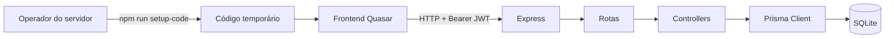

# Alúria API

API Node.js/Express do Alúria, sistema escolar open-source e self-hosted. O serviço expõe autenticação administrativa, bootstrap seguro da primeira instalação e os recursos acadêmicos atualmente presentes no código.

## Estado e limites atuais

Implementado:

- autenticação de administrador por JWT com expiração de duas horas;
- bootstrap inicial protegido por código temporário gerado no terminal;
- persistência do estado da instalação em `InstallationState`;
- CRUD de administradores, professores, alunos, turmas, notas, frequência e meses, conforme as rotas registradas;
- SQLite acessado por Prisma.

Ainda não implementado: autorização granular, papéis configuráveis, escopo por turma/disciplina e gerenciamento seguro de permissões da ALU-003. Atualmente, a maior parte das rotas protegidas verifica apenas a presença e validade de um JWT. A referência completa, inclusive inconsistências conhecidas, está em [docs/API.md](./docs/API.md).

## Arquitetura



Estrutura principal:

```text
src/
├── app.js                 Express, middlewares e montagem das rotas
├── index.js               servidor HTTP
├── cli/setupCode.js       geração operacional do código de bootstrap
├── controllers/           regras atuais dos recursos
├── middlewares/           middleware JWT
├── routes/                contratos HTTP registrados
├── setupSecurity.js       hashing, expiração e validação do bootstrap
└── db/                    utilitários legados de SQLite
prisma/schema.prisma       modelos e relações Prisma
test/                      testes Node.js existentes
```

## Requisitos e instalação

Use Node.js compatível com as dependências atuais e npm.

```bash
npm install
```

Crie `.env` a partir de [.env.example](./.env.example), substituindo `JWT_KEY` por uma chave aleatória forte que não seja versionada:

```dotenv
JWT_KEY=uma-chave-aleatoria-longa-e-secreta
PORT=3002
```

### Banco de desenvolvimento

O projeto usa SQLite pelo datasource do Prisma. Em uma instalação limpa, aplique as migrations versionadas e gere o client:

```bash
npx prisma migrate deploy
npx prisma generate
```

Não distribua `database.db`, `.env`, tokens ou credenciais. Para desenvolvimento local, confirme o caminho do banco antes de qualquer operação de reset; este repositório não autoriza apagar bancos externos ou de localização incerta.

### Código inicial e servidor

Com o banco sem administrador:

```bash
npm run setup-code
npm run dev
```

`setup-code` imprime o código apenas no terminal do operador. O frontend usa esse código em `/setup`. Para execução sem hot reload:

```bash
npm start
```

O servidor escuta `PORT` ou `3002` por padrão.

### Testes

```bash
npm test
```

O script usa o runner nativo `node --test` sobre `test/**/*.test.js`. Os testes existentes cobrem principalmente o login de administrador e seus casos de validação; veja os arquivos do diretório [test/](./test/). Não há alegação de cobertura integral dos módulos acadêmicos.

## Bootstrap inicial

1. `npm run setup-code` cria ou atualiza o código criptograficamente aleatório no banco.
2. O código é armazenado apenas como hash e expira em 15 minutos.
3. A API aceita no máximo cinco tentativas; depois aplica bloqueio temporário de 15 minutos.
4. `POST /setup/bootstrap` valida código, nome, e-mail e senha, cria o primeiro administrador com bcrypt e atualiza `InstallationState` em uma transação.
5. Ao concluir, o código é removido, a instalação fica `CONFIGURED` e novas inicializações retornam conflito, inclusive após reiniciar o processo.

O endpoint não retorna o código, hash ou senha. O operador deve entregar o código por canal seguro e não o registrar em logs ou documentos públicos. A proteção atual não substitui HTTPS, firewall e gestão de segredos em uma implantação exposta à internet.

## API

A aplicação registra 43 endpoints públicos: 6 de administradores, 5 de professores, 6 de alunos, 6 de turmas, 6 de frequência, 6 de mês, 5 de notas, 1 de serviços e 2 de setup. A lista completa, com método, corpo, parâmetros, autenticação, respostas observadas e limitações, está em [docs/API.md](./docs/API.md).

Resumo de autenticação:

- `POST /admin/login`, `POST /services/auth` e os endpoints de setup não exigem JWT;
- os demais endpoints registrados exigem `Authorization: Bearer <token>`;
- não existe verificação de papel, permissão ou escopo por recurso;
- o token contém `id_usuario` e `email`, não permissões.

## Modelos Prisma

- `InstallationState`: singleton que guarda `UNCONFIGURED`/`CONFIGURED`, hash e validade do código, tentativas, bloqueio e timestamps.
- `administradores`: nome, dados cadastrais, e-mail único e senha hash para o login.
- `professores`: dados cadastrais, senha opcional e identificador próprio; o schema atual não possui relação funcional com administrador.
- `Aluno`: dados cadastrais, senha atualmente armazenada pelo controller sem hash, referências opcionais a professor e turma e relação com `notas`.
- `Turma`: nome e relação singular existente com professores conforme o schema atual.
- `notas`: dados de notas e relação opcional com aluno.

O schema não contém entidades de disciplinas, papéis ou permissões. Alguns controllers ainda usam campos/relacionamentos que não coincidem com o schema atual; essas limitações estão preservadas na documentação da API e não foram mascaradas por este README.

## Segurança conhecida

Proteções efetivas: bcrypt no login e no primeiro administrador, hash SHA-256 com comparação em tempo constante para o código de setup, expiração, limite de tentativas, transação de bootstrap, JWT assinado e bloqueio de criação anônima em `POST /admin/`.

Limitações relevantes: qualquer token JWT válido pode chamar rotas protegidas; o `POST /admin/` autenticado ainda não exige uma permissão administrativa granular; dados retornados por vários controllers incluem campos sensíveis; alunos e professores não têm hashing aplicado no cadastro; `POST /services/auth` aceita token no corpo e sua mensagem de erro pode refletir o token recebido; tratamento de erros e códigos HTTP são inconsistentes. A correção dessas lacunas pertence ao trabalho aprovado da ALU-003 ou a uma tarefa de segurança específica.

## Licença e roadmap

O projeto é preparado para distribuição independente por escolas. A ALU-001 e a ALU-002 estão concluídas conforme os checkpoints do workspace. A ALU-003 continua em planejamento arquitetural; suas permissões docentes automáticas foram registradas como direção aprovada, mas não foram implementadas neste repositório.
